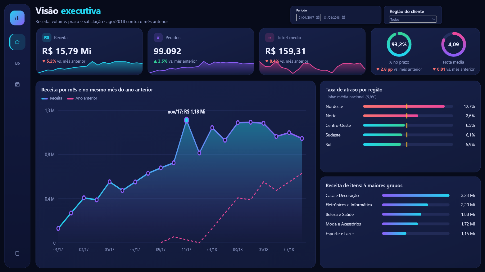

# Power BI: relatório executivo (Etapas 5 e 8)

Relatório em três páginas sobre o star schema das marts, com DAX de inteligência
de tempo, RLS dinâmico por região e por vendedor e OLS sobre os dados do cliente.
Na Etapa 8 o desenho inteiro passou a ser **HTML e CSS gerados por medidas DAX**
(cartões, anéis, gráficos em SVG, tabelas e um dicionário de métricas), sem mudar
nenhum número. Tudo versionado em texto: o modelo em **TMDL** e o relatório em
**PBIR**, dentro de um projeto **PBIP**. O PDF e os prints estão em `docs/prints/`.



| Página | O que mostra |
|---|---|
| [Visão executiva](../../docs/prints/powerbi-executivo.png) | receita, pedidos e ticket médio com a variação do último mês e mini-gráfico; anéis de % no prazo e nota média; receita por mês contra o mesmo mês do ano anterior (destaque no maior mês); taxa de atraso por região contra a nacional; os 5 maiores grupos de categoria |
| [Entrega e risco](../../docs/prints/powerbi-entrega-risco.png) | taxa de atraso com a variação em pontos percentuais; pedidos em alerta e receita em risco; atraso por região; atraso em excesso por UF em barras divergentes (RJ no topo, SP no fim da lista); os 50 pedidos em andamento de maior probabilidade de atraso |
| [Vendedores](../../docs/prints/powerbi-vendedores.png) | receita de itens, itens e taxa de atraso dos itens; receita por grupo de categoria; os 50 vendedores de maior receita com barra em cada linha. É a página do perfil Vendedor |
| [Dicionário de métricas](../../docs/prints/powerbi-dicionario.png) | painel lateral em todas as páginas (ícone de livro no menu): busca uma métrica e mostra o que é, como é calculada e um exemplo com os números do painel |

PDF com as três páginas e o dicionário aberto: [docs/prints/powerbi-olist.pdf](../../docs/prints/powerbi-olist.pdf).

**Visual.** Fundo azul-marinho, blocos com degradê e borda fina, destaque em ciano e
violeta, mesma paleta do painel web. A cor só aparece quando diz algo: ▲ verde e
▼ vermelho na variação do último mês (na taxa de atraso, subir é vermelho), barras
de região acima da taxa nacional em vermelho, atraso em excesso acima do esperado
em rosa e vermelho e probabilidade de atraso com fundo âmbar (30%+) ou vermelho
(40%+). Segmentações, navegação e botões continuam nativos, por cima do HTML: o
menu lateral é desenhado em HTML e um navegador de páginas invisível fica sobre os
ícones. No Desktop, em modo de edição, navegador e botões respondem a Ctrl +
clique; no modo de leitura e no Service, a um clique.

## HTML por DAX (Etapa 8)

Cada bloco da página é um visual **HTML Content** com uma medida só (pasta `HTML`
de `_Medidas`, 19 medidas). A medida monta o HTML como texto: `FORMAT` para os
números, `CONCATENATEX` para linhas de tabela e barras, `RANKX` para a posição de
cada mês no SVG. Os números vêm das medidas que já existiam (`[Receita]`,
`[Taxa de Atraso]`, `[Δ Receita]`...), nunca recalculados, então a conferência
continua valendo. Dois moldes ocultos (`HTML Menu Base`, `HTML Cabeçalho Base`)
evitam repetir o menu e o cabeçalho nas três páginas.

**Por que assim.** Os visuais nativos não fazem anel com degradê, mini-gráfico
dentro do cartão nem tabela com barra por linha. Um visual próprio em TypeScript
faria, mas sairia do Power BI (outro projeto, outro build); HTML por DAX fica no
modelo, versionado e testável como qualquer medida.

**O visual.** HTML Content 2.0.0 na edição **Standalone**, importada de arquivo e
guardada dentro do relatório (`Olist.Report/CustomVisuals/`). As edições da loja
usam o identificador da loja e só carregam como visual da organização, o que pede
um administrador. Origem e licença (MIT) em [terceiros/](terceiros/README.md). Se
o visual sumir, importe o `HTML-Content-Standalone.2.0.0.pbiviz` em Visualizações
> ... > Importar um visual de um arquivo.

**Limites que valem para quem for mexer:**

- **Sem JavaScript.** O visual remove scripts; tudo que é interativo (filtros, abas,
  painel do dicionário) é nativo do Power BI.
- **Nada carregado de fora.** Ícones são SVG escritos na própria medida; fonte é a
  do sistema.
- **Texto escapado.** Rótulos que vêm do banco (vendedor, categoria, texto do
  dicionário) passam por `SUBSTITUTE` de `&`, `<` e `>` antes de entrar no HTML.
- **Coordenada de SVG com ponto.** `FORMAT(x, "0.0", "en-US")`: na cultura pt-BR o
  separador seria vírgula e o SVG quebraria.
- **Medida grande é difícil de ler.** As 19 medidas são geradas por um script e
  ficam com um comentário `///` cada; mude a medida pelo texto, não pelo editor.

## Dicionário de métricas

Tabela `dicionario_metricas`, calculada com `DATATABLE` no próprio TMDL (texto
versionado, uma linha por métrica: `Métrica`, `O que é`, `Cálculo`, `Exemplo`,
`Página`). Não se relaciona com nada e não entra no RLS. Os exemplos são os
números da janela padrão, conferidos contra o SQL.

Em cada página, o ícone de livro no pé do menu abre o painel: segmentação com
busca na coluna `Métrica` (várias marcadas sem Ctrl) e o visual `HTML Dicionário`,
que mostra até 3 métricas como cartões ("e mais N" acima disso; sem seleção, pede
para escolher). Abrir e fechar são dois **indicadores por página**, aplicados só
aos visuais do painel e **sem dados** (`suppressData`): abrir o dicionário não
desfaz o período escolhido. O relatório é salvo com o painel fechado, e um teste
garante isso.

## Como abrir

Pré-requisitos: Power BI Desktop (testado na versão 2.158 da Microsoft Store) e o
Postgres local com as marts construídas (`dbt build`, que também carrega o seed
de segurança).

1. Abra `Olist.pbip`.
2. Na primeira atualização o Desktop pede a credencial do Postgres: escolha
   **Banco de dados** e use o usuário e a senha do `.env`. A credencial fica nas
   configurações do Desktop, nunca no projeto.
3. O Desktop avisa que a conexão não é criptografada. Aceite **só para o
   `localhost`**: o Postgres do Docker não tem SSL configurado e o tráfego não sai
   da máquina.
4. **Atualizar.** A carga leva uns 3 minutos (cerca de 440 mil linhas em oito
   tabelas). Depois disso o cache (`.pbi/cache.abf`, fora do Git) abre o modelo
   sem nova carga.

**Para ligar no Neon**, troque os parâmetros `ServidorPostgres` e `BancoPostgres`
(Transformar dados > Gerenciar parâmetros). Lá a conexão criptografada é
obrigatória: não aceite o aviso de conexão sem criptografia.

## Estrutura

```
Olist.pbip
Olist.SemanticModel/definition/   modelo em TMDL
  expressions.tmdl                parâmetros de conexão
  tables/                         uma tabela por arquivo (Import, Power Query);
                                  dicionario_metricas é calculada (DATATABLE)
  relationships.tmdl              7 relações, todas um para muitos
  roles/                          papéis de RLS e OLS
Olist.Report/definition/          relatório em PBIR (páginas e visuais em JSON)
  bookmarks/                      indicadores que abrem e fecham o dicionário
Olist.Report/CustomVisuals/       visual HTML Content (Standalone), guardado no relatório
Olist.Report/StaticResources/     tema na paleta do painel web
gerar_medidas_html.py             gera as 19 medidas HTML em _Medidas.tmdl
gerar_versao_publica.ps1          cópia sem RLS para "Publicar na Web" (em publico/, fora do Git)
conferencia/                      teste automático do modelo contra o SQL
terceiros/                        origem e licença do visual HTML Content
```

## Modelo

Import, lendo só as tabelas de `marts` que o relatório usa: `fato_pedidos` e
`fato_itens_pedido` (dois grãos), as dimensões de cliente, produto, vendedor e
tempo, `previsao_atraso` (Etapa 4) e `seguranca_bi` (oculta). As OBTs ficam de fora:
elas existem porque o Looker só junta fontes por blend, e o VertiPaq trabalha
melhor com o star schema.

O Olist anonimiza vendedores e pedidos com hashes de 32 caracteres. Para leitura,
o dbt gera `vendedor_rotulo` em `dim_vendedores` (cidade/UF e os 6 primeiros
caracteres, por exemplo `Ibitinga/SP · 4a3ca9`, com a cidade da origem limpa) e o
Power Query recorta o pedido em `#` mais 10 caracteres. As colunas de valor são
tipadas como moeda no M.

Não existe relação entre os dois fatos. Produto e vendedor só existem no grão de
item, e é o RLS do Vendedor que leva o filtro de itens para os pedidos (ver
Segurança).

## Medidas

30 medidas de número na tabela `_Medidas`, em pastas: Vendas, Tempo, Entrega,
Satisfação, Risco, Vendedores e Destaques, mais 10 medidas de cor ocultas (pasta
Cores, da Etapa 5) e as 19 medidas de desenho da pasta HTML (Etapa 8, ver acima).
Cada uma tem descrição no próprio modelo. Pontos que valem a leitura:

- **`Atrasos` usa `==`, não `=`.** Em DAX, `BLANK() = FALSE()` é verdadeiro: com `=`,
  os 2.965 pedidos sem entrega entravam como atraso (9.500 em vez de 6.535), e o %
  no prazo caía de 93,2% para 90,2%. A conferência pegou na primeira execução.
- **`Taxa Nacional de Atraso`** tira o filtro de cliente com `REMOVEFILTERS`, e
  `Atraso em Excesso` compara cada recorte com ela. O RJ fica em +659 na base
  inteira, o mesmo número da análise da Etapa 2 (+660 na janela padrão em que o
  relatório abre, e SP em -926).
- **`Variação Mensal %`** de jan/2017 dá +69.127,8%: dez/2016 teve um único pedido
  (R$ 19,62). O número é real e o título da tabela explica. Uma versão que
  deixava em branco o mês cujo anterior está fora do período foi descartada: com
  um único mês selecionado, ela apagava a variação daquele mês.

- **Destaques dos cartões** (`Δ Receita`, `Δ % no Prazo` e outras) comparam o
  último mês com venda dentro do período (`Mês de Referência`, ago/2018 na janela
  padrão) com o mês anterior. Variação do período inteiro contra o período
  deslocado não diz nada; a do último mês é a que um gestor lê. Taxas variam em
  pontos percentuais, não em %. A seta faz parte do formato da medida.

As medidas de risco (`Pedidos em Alerta`, `Receita em Risco`) só contam os
conjuntos `teste` e `em_andamento`, porque as previsões sobre treino e validação
são otimistas.

## Segurança

**RLS dinâmico.** Os usuários estão em `seguranca_bi`, um seed do dbt
(`dbt/seeds/seguranca_bi.csv`) com e-mails fictícios em `@exemplo.com.br`. Cada
papel filtra pela linha do próprio usuário (`USERPRINCIPALNAME()`):

| Papel | O que vê |
|---|---|
| Diretoria | tudo |
| Gerente regional | clientes das regiões do usuário, e os pedidos e itens deles |
| Vendedor | os próprios itens e os pedidos que têm item dele |

Incluir alguém é uma linha nova no seed: quem administra acesso não mexe no
modelo, e um papel por região ou por vendedor não precisa existir. Um e-mail fora
do seed, nos papéis Gerente regional e Vendedor, não vê nenhum pedido nem item (as
dimensões sem filtro, como a lista de vendedores para um gerente, continuam
visíveis). Um teste do dbt garante que cada linha do seed é coerente com o perfil.
Um mesmo usuário não pode estar ao mesmo tempo num papel com OLS e em outro: o
Power BI não combina OLS e RLS entre papéis e devolve erro.

**OLS.** No papel Vendedor, `customer_unique_id`, `zip_code_prefix` e `cidade` de
`dim_clientes` ficam com permissão `none`. O vendedor vê quanto vendeu e para qual
UF, não quem comprou. A chave `cliente_sk` continua nos fatos, oculta: é um md5
de `customer_unique_id`, um pseudônimo. Pela LGPD pseudônimo ainda é dado
pessoal; em produção, a chave teria sal ou o OLS cobriria a coluna também.
Nenhuma medida depende dessas colunas, e todas as 40 foram avaliadas no papel
Vendedor sem erro.

**Duas consequências registradas:**

- **RLS e taxa nacional.** `REMOVEFILTERS` não atravessa o RLS. Para um gerente
  regional, a "taxa nacional" vira a taxa da região dele, e o atraso em excesso
  tende a zero. É o comportamento certo (ele não pode ver o resto do país), e
  mostra por que medida comparativa precisa ser pensada junto com a segurança.
- **Pedidos com mais de um vendedor.** 1.278 pedidos (1,3%) têm itens de vendedores
  diferentes. No papel Vendedor, a receita desses pedidos aparece inteira nas
  medidas de `fato_pedidos`. As medidas de item são as exatas, e a página
  Vendedores usa só elas.

## Conferência

O teste automático fica em [conferencia/](conferencia/): consulta o modelo aberto
por DAX e compara com o mesmo número calculado em SQL.

| Grupo | Casos | Resultado |
|---|---|---|
| Linhas de cada tabela | 8 | iguais ao banco |
| Medidas (receita, ticket, % no prazo, nota, excesso do RJ, acumulado no ano até mar/2018, variações, destaques do último mês, risco) | 13 | diferença abaixo de 0,000001 |
| HTML e dicionário (texto que a medida deve conter, não conter ou contar, na janela padrão) | 19 | todos ok |
| Papéis (usuário fora do seed e OLS) | 8 | ok nos três papéis |
| Usuários do seed e um e-mail fora dele, pelo "Exibir como" | 6 | iguais ao SQL |

Os casos de HTML conferem o que a pessoa lê: "R$ 15,79 Mi" e "99.092" nos
cartões, 20 pontos no gráfico de receita com nov/2017 em destaque, +660 e -926 no
excesso por UF, 51 linhas (cabeçalho e 50) nas tabelas, "sem dados" num ano sem
pedido, o escape de `&` e o dicionário sem seleção, com uma e com quatro
métricas. A execução padrão roda modelo, medidas e HTML (40 casos).

O motor local do Desktop não aceita personificar um e-mail que não é conta do
Windows, então os usuários do seed são conferidos pelo "Exibir como". O
procedimento e os números estão no [README da conferência](conferencia/README.md).

O relatório abre com a janela de jan/2017 a ago/2018, a mesma do Looker, e nela
os cartões mostram 99.092 pedidos e R$ 15,79 mi, conferidos contra o SQL da
janela. Sem a janela, os totais são os da conferência: 99.441 pedidos e
R$ 15,84 mi.

## Publicação

**"Publicar na Web" não aceita modelo com RLS.** O relatório versionado continua
com os papéis e o OLS; o que vai para a web é uma cópia sem eles, gerada por
script numa pasta fora do Git:

```powershell
powershell -ExecutionPolicy Bypass -File dashboards/powerbi/gerar_versao_publica.ps1
```

O script copia `Olist.pbip`, o relatório e o modelo (com o cache de dados
`.pbi/cache.abf`, para abrir sem atualizar) para `dashboards/powerbi/publico/`,
apaga `definition/roles` e tira as linhas `ref role` do `model.tmdl`. Um teste roda
o script de verdade e confere que a cópia não tem papel e que o resto é idêntico.
A tabela `seguranca_bi` vai junto: só tem e-mails fictícios.

**Roteiro de publicação (feito pelo dono, pela conta de estudante):**

1. Gere a cópia com o comando acima.
2. No Power BI Desktop, entre com a **conta de estudante** (nunca a de trabalho:
   o relatório ficaria no ambiente da empresa e o link sairia em nome dela).
3. Abra `dashboards/powerbi/publico/Olist.pbip` e confira em Modelagem >
   Gerenciar funções que não há nenhum papel.
4. Página Inicial > Publicar > **Meu workspace**.
5. No Service, abra o relatório: Arquivo > Inserir relatório > **Publicar na Web
   (público)** e copie o link.

Cuidados: "Publicar na Web" deixa o relatório aberto para qualquer pessoa, sem
login, e é indexável; aqui os dados são um dataset público, mas em empresa isso
quase nunca é permitido. O administrador do ambiente de estudante precisa
permitir o recurso; se estiver bloqueado, a Etapa 8 fica sem link público. O
relatório publicado é um retrato: a base é estática e não há atualização
agendada (o Service não alcança o Postgres local).

## Armadilhas encontradas

- **Salvar no Desktop sobrescreve o TMDL** com o que está na memória. Editou um
  arquivo por fora? Use **Apply external changes** na barra que o Desktop mostra,
  nunca salve antes.
- **Coluna sem tipo no Power Query vira `double` ao salvar.** Para dinheiro, o
  certo é `Currency.Type` no M. Efeito colateral: moeda é decimal fixo de 4 casas,
  e moeda dividida por inteiro sai arredondada ali (o ticket médio é 159,3262, não
  159,32616...). A conferência compara na mesma precisão.
- **`CALCULATE` com predicado substitui o filtro da coluna.** As medidas de
  entrega e de risco usam `KEEPFILTERS`, para um visual por `conjunto` ou por
  `entregue_no_prazo` mostrar a interseção, não o total.
- **Exportar PDF sob "Exibir como"** gera uma imagem cortada da tela. Os prints
  saem do PDF exportado sem papel nenhum.

Da Etapa 8 (HTML Content no Desktop):

- **A exportação para PDF só desenha o HTML da página aberta,** e na escala do
  zoom da tela: com 46% de zoom a página sai num canto, reduzida. Os prints saem
  um por exportação, com a página aberta e zoom de 100% ("Tamanho real"), e o PDF
  versionado junta as quatro imagens.
- **A exportação guarda cache por visual.** Depois de mudar uma medida HTML, o PDF
  ainda trazia o desenho antigo, mesmo com a tela certa. Dar um nome novo à pasta
  do visual força o redesenho.
- **Texto em degradê (`background-clip:text`) sai como um bloco colorido** no
  PDF. O destaque do título é ciano sólido, e um teste impede a volta.
- **Bloco com `height:100vh` sem `overflow:hidden`** ganha uma barra de rolagem
  fina na borda.
- **Medida nova aparece com o desenho antigo** até Otimizar > Atualizar visuais.
- **Salvar com o dicionário aberto grava o painel aberto** no PBIR. Um teste
  garante que os visuais do painel estão ocultos nos arquivos.
- **O Desktop escreve sinônimos de Q&A** em `cultures/pt-BR.tmdl` a cada medida
  nova (mais de mil linhas). Não muda o relatório; esse ruído não entra nos
  commits.
- **Formatação de um visual existente não é relida** do JSON em "Apply external
  changes" (o navegador de páginas continuou com texto e borda). Visual novo é
  lido inteiro; para um existente, ajuste no painel de formato.
