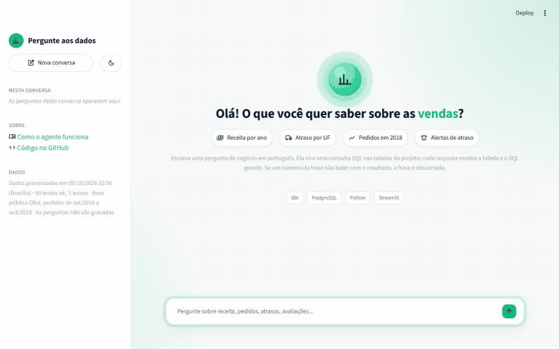
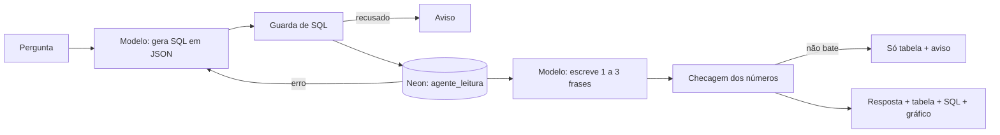

# Agente de IA sobre as marts (Etapa 6)

**App:** [painel-olist.streamlit.app](https://painel-olist.streamlit.app/) (página "Pergunte aos
dados" e a coluna "Tire sua dúvida" das páginas do painel, ver
[painel-web.md](painel-web.md))



Pergunta de negócio em português vira SQL sobre o star schema, o SQL roda num
usuário de banco somente leitura, e a resposta mostra o número, a tabela, o SQL e,
quando cabe, um gráfico. Modelo gratuito (Gemini), app público no Streamlit
Community Cloud lendo o Neon.

O risco que guiou o desenho já estava no ROADMAP: **resposta errada com cara de
certa**. Ao gerar o mockup do dashboard, um modelo inventou os valores de 6 das 9
UFs do mapa. Por isso o agente tem três defesas contra isso: o SQL sempre
visível, a resposta escrita só a partir das linhas que o banco devolveu (com
checagem automática dos números) e uma avaliação com perguntas de resposta
conhecida.

## Como funciona



| Peça | Arquivo | O que faz |
|---|---|---|
| Esquema | `agente/esquema.py` → `esquema_marts.md` | Descrição das 8 tabelas permitidas para o prompt (grão, colunas, significado), gerada dos `.yml` do dbt e versionada |
| Modelo | `agente/llm.py` | Gemini Flash; se a cota acaba ou ele está sobrecarregado (429, 503), Gemini Flash-Lite (cota separada, mesma chave); Groq opcional por último |
| Guarda | `agente/guarda_sql.py` | Análise sintática (`sqlglot`): um comando só, só leitura, só tabelas permitidas, sem funções perigosas, `LIMIT 1000` |
| Banco | `agente/banco.py` | Transação somente leitura e tempo máximo de 5 s |
| Checagem | `agente/numeros.py` | Todo número da frase precisa estar no resultado, na precisão em que foi escrito |
| Gráfico | `agente/grafico.py` | Regra pela forma do resultado: série no tempo vira linha, ranking curto vira barras |
| Fluxo | `agente/agente.py` | Junta tudo, com uma segunda tentativa quando o banco devolve erro |
| App | `agente/app.py` | Chat em Streamlit, 20 perguntas por sessão, avisos de cota e de banco acordando |
| Apresentação | `agente/apresentacao.py` | Números no formato brasileiro fixo (8.643.697,60; 21,41%), ano sem casa decimal, tabela em HTML com escape, eixo em mil/mi |
| Tema | `agente/tema.py` | Claro (padrão) e escuro, trocados por um botão na barra lateral; CSS por sessão, versão do Streamlit fixada |

O modelo recebe as 3 últimas perguntas e SQLs da sessão, então entende
continuação ("e no Nordeste?"). Os resultados não vão para o histórico, para
economizar cota.

## Defesas

**No banco, a que não depende do modelo obedecer.** O usuário `agente_leitura`
tem `SELECT` só nas tabelas permitidas, concedido tabela por tabela,
`default_transaction_read_only`, `statement_timeout` de 5 s e no máximo 3
conexões. Fora da lista ficam as OBTs (o modelo misturaria grãos), a
`seguranca_bi` (lista de acessos do Power BI) e todo schema que não é `marts`. A
`atualizacao_dados` é legível para o rodapé do app, mas a guarda não a aceita em
SQL do modelo. O `publicar_marts.py` apaga e recria as tabelas no Neon, o que
apaga as permissões; ele as reaplica no fim de cada publicação, e se falhar o
agente fica sem acesso, nunca com acesso a mais.

**Na guarda.** Recusa dois comandos com `;`, escrita (inclusive escondida numa CTE
como `WITH x AS (DELETE ...)`), `SELECT ... INTO`, `FOR UPDATE`, tabela fora da
lista com ou sem schema (`raw.`, `meta.`, `pg_catalog.`, `information_schema.`),
CTE usada fora do próprio escopo (uma CTE criada numa subconsulta não "libera" o
nome `pg_roles` lá fora) e famílias de funções que leem o servidor ou executam SQL
em texto (`pg_*`, `lo_*`, `dblink*`, `query_to_xml` e `*_to_xml`, `version()`,
`set_config`). SQL que nem dá para ler vira recusa, não erro. A análise é pela
árvore do SQL, não por texto: comentário e caixa não enganam.

A revisão final do PR achou esses dois furos (a CTE fora do escopo e as funções
`*_to_xml`), que liam metadados do catálogo como o usuário do agente. Dado nenhum
vazava, porque o banco só concede as tabelas da lista, mas era uma defesa
documentada que não se sustentava; os dois casos viraram teste.

**Na resposta.** A frase do modelo só aparece se cada número dela estiver no
resultado: "R$ 15,79 mi" casa com 15.786.203,57 e "659" com 658,65, mas "8.468"
não casa com 8.467. Se algum número não bater, a frase é descartada e o app mostra
a tabela com o aviso "Resposta automática não confirmada".

**No app.** Pergunta com até 300 caracteres, 20 perguntas por sessão, nenhuma
pergunta gravada. Cota esgotada, modelo sobrecarregado e banco acordando viram
aviso, nunca erro na tela. Cada pergunta abre e fecha a própria conexão: uma
conexão guardada morre quando o Neon dorme e, compartilhada entre visitantes,
misturaria transações.

Tudo isso tem teste: 126 testes automáticos (guarda com casos de ataque, checagem
de números, gráfico, fluxo com modelo falso, tela com `AppTest`) e testes de
integração que, no CI, criam o usuário com o mesmo código do Neon e confirmam que
`DROP`, `INSERT`, leitura fora da lista e consulta longa falham.

## Avaliação

`agente/avaliacao/perguntas.yaml` tem 25 perguntas com a resposta esperada escrita
em SQL à mão: 8 diretas, 6 com junção, 5 de tempo, 3 de continuação (dependem da
pergunta anterior) e 3 fora do escopo. `python -m agente.avaliacao.avaliar` roda
todas contra o Neon e compara o **resultado** da consulta do agente com o da
consulta esperada (não o texto do SQL: há várias formas certas de escrever).
Também conta as frases que passaram pela conferência de números.

| Rodada | Acertos | Frases conferidas | O que mudou depois |
|---|---|---|---|
| 1 | interrompida | - | erro 503 do modelo derrubava a avaliação; 5xx passou a cair para o modelo reserva |
| 2 | 25/25 | não medido | coluna de frase conferida adicionada ao relatório |
| 3 | 24/25 | 21/22 | ver abaixo |
| 4 | 25/25 | 22/22 | a revisão final mostrou que a comparação em 2 casas empatava taxas como 0,0812 e 0,0789 |
| 5 | 25/25 | 21/22 | versão final, com taxas comparadas em 4 casas e totais no centavo |

Na rodada 3, a d07 ("quantos pedidos foram entregues com atraso?") veio com um
filtro a mais, `foi_entregue`, que muda a contagem. É uma leitura defensável da
pergunta, mas diferente da definição do projeto, e foi contada como erro. A frase
não conferida da mesma rodada era alarme falso: o rótulo do vendedor tem dígitos
(cidade/UF e o início do código, ex.: "Ibitinga/SP · 4a3ca9") e a conferência os lia como números inventados. Dígitos
dentro de células de texto do resultado passaram a contar como conferidos.

Na rodada 5, a frase não conferida (j06) estava certa: "o RJ lidera com 226
pedidos ... o restante das 23 UFs". O 23 é a quantidade de linhas, que não é um
valor do resultado, e a checagem descartou a frase. É alarme falso para o lado
seguro: quem pergunta vê a tabela com o aviso, não um número errado.

Nas rodadas 3 a 5, todas as respostas vieram do Gemini Flash-Lite: a cota diária do
Flash já tinha acabado nas rodadas anteriores, e a troca para a reserva foi
automática. Ou seja, o resultado vale para o modelo menor, que é o que atende
quando o dia está movimentado.

O que essa avaliação **não** garante: 25 perguntas não cobrem a variedade de quem
escreve livremente, e o modelo não é determinístico. Por isso cada resposta mostra
a tabela e o SQL, e a frase com número que não bate com o resultado é descartada.

## Limites

- **Cota gratuita.** Cada pergunta usa 2 chamadas ao modelo (3 com a nova
  tentativa). A cota do Google varia por conta; com Flash e Flash-Lite, a conta é
  de algumas centenas de perguntas por dia. Sem login nem limite global, um
  visitante insistente pode esgotar a cota abrindo várias sessões. Para um
  portfólio, é aceitável.
- **Interpretação.** O modelo pode ler uma pergunta de um jeito defensável e
  diferente da definição do projeto (exemplo na avaliação). O SQL visível é o que
  permite a quem lê perceber.
- **Mesmo fornecedor.** Sem a chave do Groq, as duas camadas são do Google: se o
  serviço cair, o agente avisa e para.
- **Dados de 2016 a 2018.** Perguntas sobre outro período são recusadas.

## Como publicar

1. **Chave gratuita do Gemini** em [aistudio.google.com/apikey](https://aistudio.google.com/apikey),
   no `.env` como `GEMINI_API_KEY`. A do Groq (`GROQ_API_KEY`) é opcional; o
   cadastro do Groq recusa e-mail Hotmail.
2. **Senha do usuário do agente** no `.env` (`AGENTE_DB_PASSWORD`, 16 ou mais
   caracteres) e `python scripts/criar_usuario_agente.py`, que cria o usuário no
   Neon com as permissões.
3. **Streamlit Community Cloud:** *Create app* → repositório
   `gustavohenriqq/pipeline-olist`, branch `main`, arquivo `agente/app.py`. Em
   *Advanced settings*, Python 3.11 e, em *Secrets*:

   ```toml
   GEMINI_API_KEY = "..."
   AGENTE_DB_HOST = "<host do Neon>"
   AGENTE_DB_PORT = "5432"
   AGENTE_DB_NAME = "<banco do Neon>"
   AGENTE_DB_USER = "agente_leitura"
   AGENTE_DB_PASSWORD = "..."
   ```

   O app instala só `agente/requirements.txt` (sem dbt nem scikit-learn). No plano
   gratuito ele dorme sem visitas e acorda em 30 a 60 segundos.

Para rodar local: `streamlit run agente/app.py`, com as mesmas variáveis no `.env`
apontando para o Postgres do Docker.
