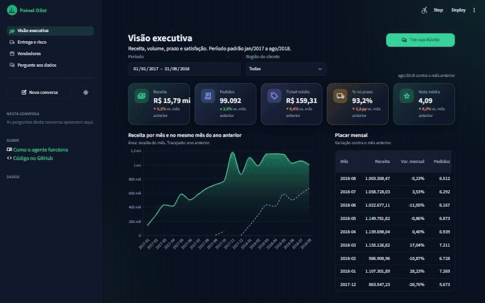

# Painel web com o agente (Etapa 7)

**App:** [olist-agente.streamlit.app](https://olist-agente.streamlit.app/)

## Por que existe

O Power BI da Etapa 5 não é publicado: publicar exige conta de trabalho ou de
escola. Quem visita o portfólio via só os prints, e o agente da Etapa 6 ficava em
outro link. Agora as três páginas do Power BI estão no mesmo app público do
agente, em HTML e CSS, e o agente abre do lado do painel sabendo o que está na
tela.

O Power BI continua sendo a peça de Power BI (DAX, RLS, OLS, modelo em TMDL). O
painel web é a vitrine aberta, com os **mesmos números**, conferidos por teste.

## Páginas

| Página | O que mostra |
|---|---|
| Visão executiva | Receita, pedidos, ticket médio, % no prazo e nota média, com o último mês contra o anterior; receita por mês contra o mesmo mês do ano anterior; placar mensal. Filtros: período e região do cliente. |
| Entrega e risco | Taxa de atraso (com o destaque em pontos percentuais), pedidos em alerta e receita em risco; taxa por região contra a nacional; atraso em excesso por UF; os 50 pedidos em andamento de maior risco, pintados como no Power BI (vermelho a partir de 40%, âmbar de 30%). |
| Vendedores | Receita de itens, itens e taxa de atraso dos itens; receita por grupo de categoria; os 50 vendedores de maior receita. |
| Pergunte aos dados | O agente da Etapa 6 em página inteira. |

Em todas as páginas do painel, **Tire sua dúvida** abre o agente numa coluna à
direita. A pergunta vai ao modelo com o contexto da tela (por exemplo "página
Entrega e risco; período 01/01/2018 a 31/08/2018"), então "qual UF atrasa mais?"
já vem no recorte escolhido. Na tela aparece só a pergunta. A conversa é a mesma
da página "Pergunte aos dados", com os mesmos limites e a mesma checagem de números.

O tema escuro é o padrão; o botão de sol na barra lateral troca para o claro. Os
filtros e o tema ficam no endereço (`?inicio=2018-01-01&fim=2018-08-31&regiao=Nordeste&tema=claro`),
então um link reproduz a mesma visão.

## Como os números são garantidos

As definições repetem as medidas DAX do Power BI: receita do pedido, pedidos
distintos, % no prazo e taxa de atraso só sobre pedidos entregues, atraso em
excesso contra a taxa nacional, alertas e receita em risco nos conjuntos `teste` e
`em_andamento`, taxa de atraso dos itens sobre os pedidos que têm itens no recorte.

`tests/integracao/test_painel_numeros.py` roda cada consulta do painel no banco do
CI e compara com:

- `dashboards/powerbi/conferencia/esperado.sql`, **o mesmo arquivo que confere o
  modelo do Power BI** (pedidos, receita, ticket, % no prazo, nota, excesso do RJ,
  variação de março, destaques da janela padrão, alertas e receita em risco);
- `painel/conferencia/esperado.sql`, casos novos escritos à mão para os visuais
  que o Power BI não tinha conferido (taxa por região, primeira UF do excesso,
  itens, grupo e vendedor de maior receita, linhas da tabela de risco).

Se o painel e o Power BI divergirem, o CI acusa.

## Peças

| Arquivo | O que faz |
|---|---|
| `agente/app.py` | Roteador (`st.navigation`), estado da sessão, tema, barra lateral |
| `painel/filtros.py` | Período e região; seleção incompleta do calendário mantém o período anterior; URL |
| `painel/consultas.py` | Uma consulta por visual, sempre com filtro como parâmetro, nunca no texto do SQL |
| `painel/cartoes.py`, `painel/graficos.py` | Cartões em HTML (com escape) e gráficos Altair nas cores do tema |
| `painel/comum.py` | Cabeçalho, filtros na tela, cache por (consulta, filtros) por 1 hora, avisos |
| `painel/lateral.py` | A coluna "Tire sua dúvida" |
| `agente/tema.py` | Paletas e CSS dos dois temas |

## Limites

- **Cold start.** O Streamlit Cloud e o Neon dormem sem uso; a primeira visita
  pode levar 30 s ou mais. O painel mostra "o banco está acordando" com "Tentar de
  novo", e cada visual carrega separado.
- **CSS sobre nomes internos do Streamlit.** A versão está fixada (1.65.0); ao
  atualizar, é preciso conferir a tela nos dois temas.
- **Duas fontes da verdade das métricas** (DAX e SQL). É o teste contra o
  `esperado.sql` que impede que elas se separem.
- **Sem segurança por usuário.** O app é público e os dados também; o RLS segue
  demonstrado no Power BI.
- **Destaque da nota média em %.** O Power BI mostra a diferença absoluta (0,01);
  o valor da nota é o mesmo.
